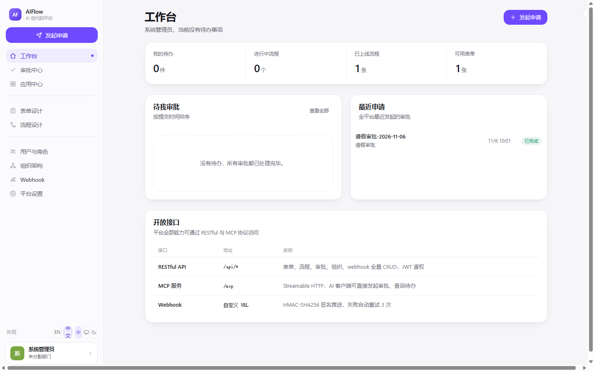
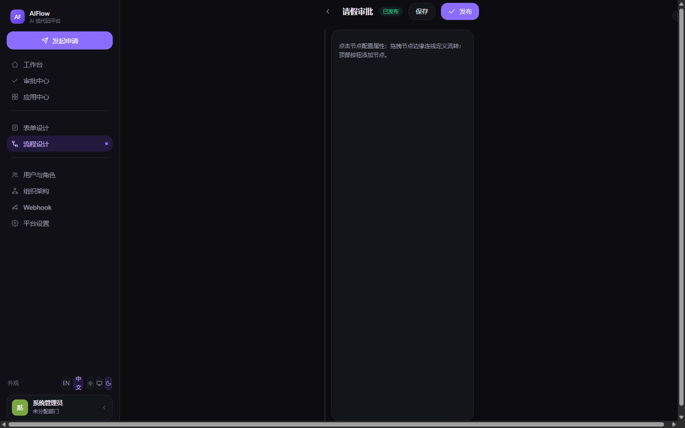
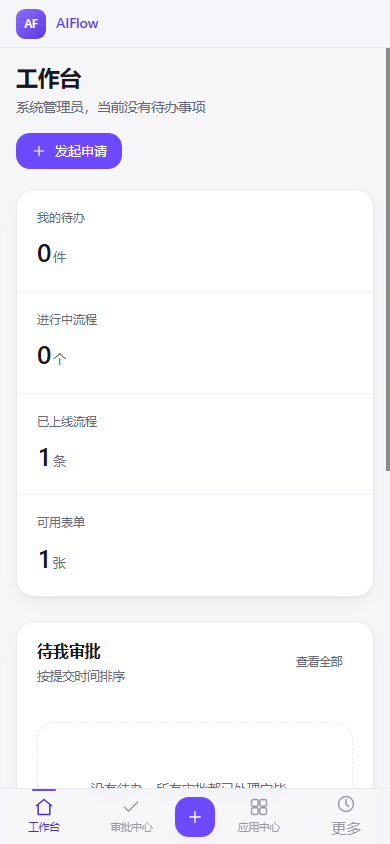
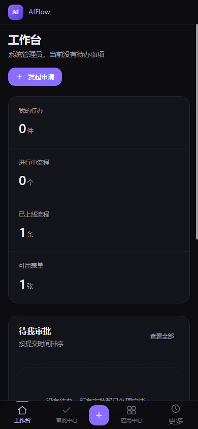

# AIFlow · AI Low-code Platform

[](LICENSE)
[](https://nodejs.org/)

**English** | [简体中文](README.zh_CN.md)

An AI low-code platform built with Node (Express) + Vite (React 19 / motion): visual form design, visual approval flows, full RESTful & MCP APIs, customizable webhooks, RBAC, SSO (OAuth2 / OIDC / CAS / WeCom / DingTalk), and MFA (TOTP / Passkey).

| Workspace (light) | Flow designer (dark) |
| --- | --- |
|  |  |

| Mobile (light) | Mobile (dark) |
| --- | --- |
|  |  |

## Features

- **Visual form designer** — 14 field types (text, number, money, select, date, switch, attachment, detail table, department, user…), drag-and-drop ordering, one-sentence AI generation
- **Visual flow designer** — React Flow canvas: start / approve / CC / condition / parallel / end nodes; conditions reference form fields; countersign or any-sign
- **Approval engine** — OR groups, AND/OR within group, 8 operators, department-manager escalation, blocked-state detection
- **RESTful API** — full CRUD for forms / flows / instances / tasks / users / roles / departments / webhooks, JWT auth
- **MCP service** — Streamable HTTP at `/mcp`, 13 tools; AI clients can start and process approvals directly
- **Webhook** — 16 event subscriptions, HMAC-SHA256 signed delivery, filters, auto-retry (5s / 30s / 2min), manual re-push
- **RBAC** — role → permission points (`resource:action`), user → multiple roles, `*` super admin
- **MFA** — TOTP (RFC 6238) + Passkey (WebAuthn), both zero-dependency implementations; policy per role or user (follow role / none / OTP / Passkey); two-step login
- **Config center** — `.env` seeded into DB on startup, then edited visually in the admin Settings page without restarting; secrets masked
- **SSO** — OAuth2 / OIDC / CAS adapters + WeCom / DingTalk QR login, CSRF-safe state, auto user provisioning
- **Organization** — department tree + members, one-click WeCom / DingTalk directory sync
- **AI** — OpenAI-compatible endpoint generates form schemas and flow definitions; offline keyword fallback
- **i18n** — English by default, switchable to Chinese; preference persisted
- **Theme** — light / dark / follow-system, fully tokenized dark mode

## Quick Start

Requires Node ≥ 20.

```bash
git clone git@github.com:liudonghua123/aiflow-platform.git
cd aiflow-platform
npm run install:all   # install server & web dependencies
npm run dev           # backend :8790 + frontend :5173 concurrently
```

Open http://localhost:5173 . Demo accounts:

| Account | Password | Role |
| --- | --- | --- |
| admin | admin123 | Super admin (all permissions) |
| zhangsan | zhang123 | Tech dept member |
| lisi | lisi123 | HR dept manager |
| wangwu | wang123 | Finance dept member |

Built-in demo: a **Leave request** form and a **Leave approval** flow (≤ 3 days → department manager; > 3 days adds HR director).

Data lives in `data/*.json` (auto-seeded on first start, gitignored). For production, swap `server/src/db.js` for SQLite/PostgreSQL without touching routes.

## Environment Variables (server)

| Variable | Description |
| --- | --- |
| `PORT` | Default `8790` |
| `JWT_SECRET` | JWT signing secret |
| `AI_BASE_URL` / `AI_API_KEY` / `AI_MODEL` | OpenAI-compatible endpoint for AI generation |
| `OAUTH2_*` / `OIDC_*` / `CAS_*` | Generic SSO protocol adapters |
| `WECOM_CORP_ID` / `WECOM_CORP_SECRET` | WeCom directory sync & QR login |
| `DINGTALK_APP_KEY` / `DINGTALK_APP_SECRET` | DingTalk directory sync & QR login |

All of the above are seeded into `data/settings.json` on startup (`cfg:` key prefix). Afterwards edit them visually on the admin **Settings** page — no restart needed. Read order: **DB → env fallback → default**; secret fields keep their existing value when submitted empty.

## MCP Integration

```json
{
  "mcpServers": {
    "aiflow": { "url": "http://localhost:8790/mcp" }
  }
}
```

Available tools: `list_forms` `get_form` `generate_form` `list_flows` `generate_flow` `start_instance` `approve_task` `reject_task` `list_my_tasks` `get_instance` `list_users` `get_org_tree` `create_user`, etc.

## Project Layout

```
server/                 Express backend
  src/
    index.js            Entry + full RESTful routes + MFA routes
    db.js               JSON-file data layer (swappable for SQLite/PG)
    rbac.js             Permission / role / org seeds
    auth.js             JWT + OAuth2/OIDC/CAS/WeCom/DingTalk adapters
    config.js           Config center (.env seeding + DB read/write + schema)
    mfa.js              TOTP + Passkey (zero-dependency WebAuthn)
    engine.js           Approval flow engine
    webhook.js          Event dispatch + HMAC signed delivery
    ai.js               AI form/flow generation
    mcp.js              MCP Streamable HTTP (/mcp)
web/                    Vite + React 19 + motion frontend
  src/
    pages/              15 pages (workspace/approvals/two designers/admin/security)
    App.jsx             Shell + router + toast + responsive navigation
    styles.css          Design system (TinyBuddy UI spec)
docs/                   Design spec, styleguide, design tokens, screenshots
```

## Design Notes

The UI follows the **TinyBuddy UI spec v0.2.1** ([source commit](https://github.com/liudonghua123/tiny-buddy/commit/ee2a698157302112a15e0c4e2c76092d21bc4b2e)). Four hard rules:

1. **Colors only via semantic tokens** — 13 semantic roles defined as `R G B` triplets; `rgb(var(--token) / alpha)` yields alpha variants; dark mode only swaps token values.
2. **Only two breakpoints** — `sm` 640px and `lg` 900px; `lg` is the only form-factor breakpoint (lowered from 1024: at Windows 125%/150% scaling a 1024px screen has only 819–911 logical px and would be misdetected as mobile).
3. **Three radii** — controls 14px / containers 18px / modals 24px; pills full.
4. **Borders over shadows** — card = 1px `--line` border + `shadow-soft`; shadows only hint elevation.

- **Desktop (≥900px)** — 252px sidebar (brand → new-request CTA → grouped nav → appearance row + user card), collapsible to 60px showing logo only; active item = `--brand-soft` background + 6px dot on the right edge.
- **Mobile (<900px)** — 48px top bar + floating pill bottom navigation with a center round FAB + "More" floating sheet; iOS safe-area aware.
- **Responsive tables** — below 900px `.table` becomes a card list via `data-label`, no JSX changes.
- **Accessibility** — global `:focus-visible` brand focus ring; `prefers-reduced-motion` degradation.

Full spec: [docs/DESIGN.en.md](docs/DESIGN.en.md) ([中文](docs/DESIGN.md)) · interactive preview: [docs/styleguide.html](docs/styleguide.html) · machine-readable tokens: [docs/design-tokens.json](docs/design-tokens.json)

## License

[MIT](LICENSE)
