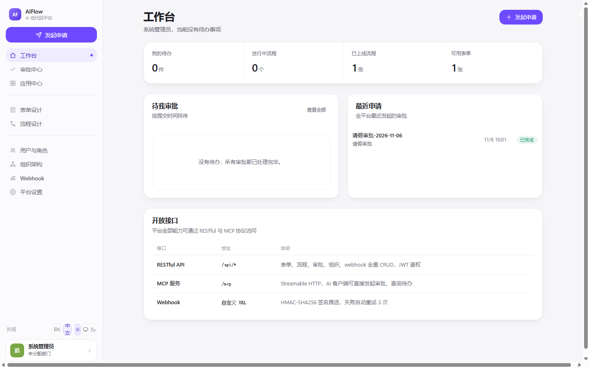
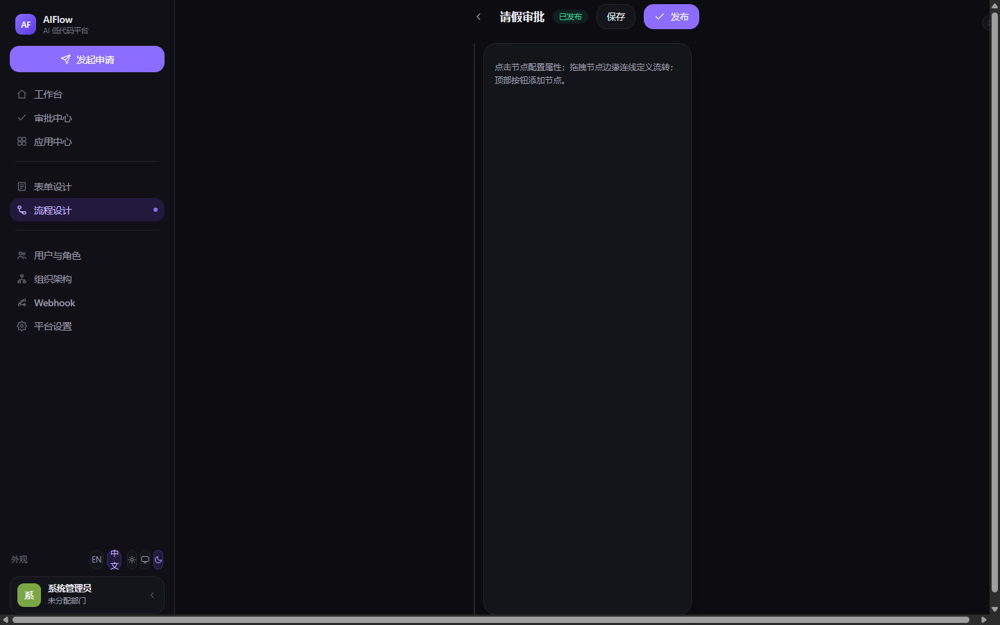
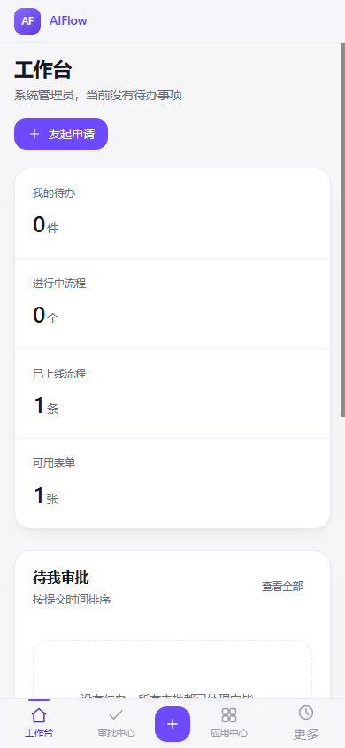
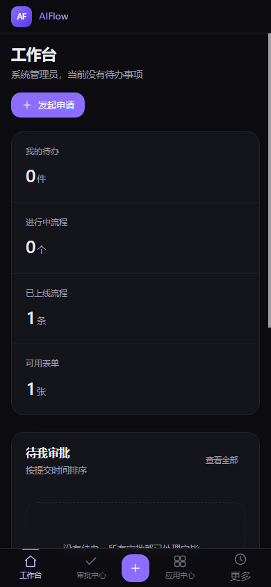

# AIFlow · AI 低代码平台

[](LICENSE)
[](https://nodejs.org/)

[English](README.md) | **简体中文**

基于 Node (Express) + Vite (React 19 / motion) 的 AI 低代码平台：可视化表单设计、可视化审批流、全量 RESTful 与 MCP 接口、可定制 Webhook、RBAC 权限、SSO（OAuth2 / OIDC / CAS / 企微 / 钉钉）与 MFA（TOTP / Passkey）。

| 工作台（浅色） | 流程设计器（深色） |
| --- | --- |
|  |  |

| 移动端（浅色） | 移动端（深色） |
| --- | --- |
|  |  |

## 功能总览

- **可视化表单设计器** — 14 种控件（文本、数字、金额、选择、日期、开关、附件、明细表格、部门、人员等），拖拽排序，AI 一句话生成
- **可视化流程设计器** — React Flow 画布：开始 / 审批 / 抄送 / 条件 / 并行 / 结束节点；条件分支引用表单字段；会签 / 或签
- **审批引擎** — 多组 OR、组内 AND/OR、8 种操作符，部门主管逐级上报，阻塞检测
- **RESTful API** — 表单 / 流程 / 实例 / 任务 / 用户 / 角色 / 部门 / Webhook 全量 CRUD，JWT 鉴权
- **MCP 服务** — 同端口 Streamable HTTP（`/mcp`），13 个 tools；AI 客户端可直接发起与处理审批
- **Webhook** — 16 个事件订阅，HMAC-SHA256 签名推送，过滤条件，失败自动重试（5s / 30s / 2min），手动重推
- **RBAC** — 角色 → 权限点（`resource:action`），用户 → 多角色，`*` 超管
- **MFA** — TOTP（RFC 6238）+ Passkey（WebAuthn），均零依赖实现；策略按角色/用户设置（跟随角色 / 不强制 / 强制 OTP / 强制 Passkey）；登录二步验证
- **配置中心** — `.env` 启动时播种入库，之后在后台「设置」页可视化修改、无需重启；secret 项掩码保护
- **SSO** — OAuth2 / OIDC / CAS 适配器 + 企微 / 钉钉扫码登录，state 防 CSRF，外部用户自动建档
- **组织架构** — 部门树 + 成员，企微 / 钉钉通讯录一键同步
- **AI 能力** — OpenAI 兼容接口生成表单 Schema 与流程定义，离线关键词模板兜底
- **i18n** — 默认英文，可切中文；偏好持久化
- **主题** — light / dark / 跟随系统，深色模式全量 token 化

## 快速开始

要求 Node ≥ 20。

```bash
git clone git@github.com:liudonghua123/aiflow-platform.git
cd aiflow-platform
npm run install:all   # 安装 server 与 web 依赖
npm run dev           # 并发启动 后端 :8790 + 前端 :5173
```

打开 http://localhost:5173 ，演示账号：

| 账号 | 密码 | 角色 |
| --- | --- | --- |
| admin | admin123 | 超级管理员（全部权限） |
| zhangsan | zhang123 | 技术部成员 |
| lisi | lisi123 | 人事部主管 |
| wangwu | wang123 | 财务部成员 |

内置演示：**请假申请** 表单 + **请假审批** 流程（≤ 3 天走部门主管，> 3 天加签人事总监）。

数据存于 `data/*.json`（首次启动自动播种，已 gitignore）。生产环境替换 `server/src/db.js` 为 SQLite/PostgreSQL 即可，路由零改动。

## 环境变量（server）

| 变量 | 说明 |
| --- | --- |
| `PORT` | 默认 `8790` |
| `JWT_SECRET` | JWT 签名密钥 |
| `AI_BASE_URL` / `AI_API_KEY` / `AI_MODEL` | OpenAI 兼容接口，配置后 AI 生成走大模型 |
| `OAUTH2_*` / `OIDC_*` / `CAS_*` | 通用 SSO 协议适配 |
| `WECOM_CORP_ID` / `WECOM_CORP_SECRET` | 企微通讯录同步与扫码登录 |
| `DINGTALK_APP_KEY` / `DINGTALK_APP_SECRET` | 钉钉通讯录同步与扫码登录 |

以上变量启动时自动播种入 `data/settings.json`（`cfg:` 前缀键），之后在后台「设置」页可视化修改即可，**无需重启**。读取顺序：**DB → env 兜底 → default**；secret 项保存时留空则保持原值。

## MCP 接入示例

```json
{
  "mcpServers": {
    "aiflow": { "url": "http://localhost:8790/mcp" }
  }
}
```

可用 tools：`list_forms` `get_form` `generate_form` `list_flows` `generate_flow` `start_instance` `approve_task` `reject_task` `list_my_tasks` `get_instance` `list_users` `get_org_tree` `create_user` 等。

## 目录结构

```
server/                 Express 后端
  src/
    index.js            主入口 + 全量 RESTful 路由 + MFA 路由
    db.js               JSON 文件数据层（可替换 SQLite/PG）
    rbac.js             权限点 / 角色 / 组织种子
    auth.js             JWT + OAuth2/OIDC/CAS/企微/钉钉适配器
    config.js           配置中心（.env 播种 + DB 读写 + schema）
    mfa.js              TOTP + Passkey（零依赖 WebAuthn 实现）
    engine.js           审批流引擎
    webhook.js          事件分发 + HMAC 签名推送
    ai.js               AI 表单/流程生成
    mcp.js              MCP Streamable HTTP（/mcp）
web/                    Vite + React 19 + motion 前端
  src/
    pages/              15 个页面（工作台/审批中心/双设计器/管理后台/账号安全）
    App.jsx             壳 + 路由 + toast + 响应式导航
    styles.css          设计系统（TinyBuddy UI 规范）
docs/                   设计规范、styleguide、设计令牌、截图
```

## 设计说明

UI 遵循 **TinyBuddy UI 规范 v0.2.1**（[来源 commit](https://github.com/liudonghua123/tiny-buddy/commit/ee2a698157302112a15e0c4e2c76092d21bc4b2e)）。四条硬性规则：

1. **颜色只走语义令牌** — 13 个语义角色以 `R G B` 三元组定义，`rgb(var(--token) / alpha)` 直接产生透明度变体；暗色只换令牌值，组件不写 `dark:`。
2. **只用两个断点** — `sm` 640px 与 `lg` 900px；`lg` 是唯一形态切换断点（由 1024 下调：Windows 125%/150% 缩放下 1024 物理屏逻辑宽仅 819~911，会被误判为移动形态）。
3. **圆角三档** — 控件 14px / 容器 18px / Modal 24px，胶囊 full。
4. **边框优先于阴影** — 卡片 = 1px `--line` 边 + `shadow-soft`；阴影只做「浮起」暗示。

- **桌面端（≥900px）** — 252px 侧栏（品牌 → 发起申请 CTA → 分组导航 → 外观行 + 用户卡），可折叠为 60px 仅显示 logo；激活态 `--brand-soft` 底 + 右缘 6px 圆点。
- **移动端（<900px）** — 48px 顶栏 + 悬浮胶囊底部导航（中部圆形 FAB）+「更多」悬浮抽屉；适配 iOS safe-area。
- **响应式表格** — `<900px` 下 `.table` 自动卡片化（列名走 `data-label`），无 JSX 改动。
- **可访问性** — 全局 `:focus-visible` 品牌焦点环；`prefers-reduced-motion` 降级。

完整规范：[docs/DESIGN.md](docs/DESIGN.md)（[English](docs/DESIGN.en.md)）· 交互式预览：[docs/styleguide.html](docs/styleguide.html) · 机器可读令牌：[docs/design-tokens.json](docs/design-tokens.json)

## License

[MIT](LICENSE)
